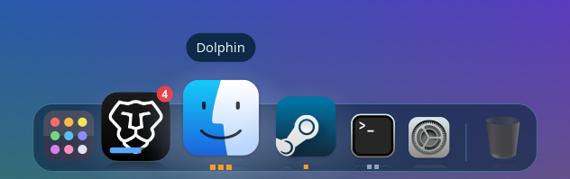
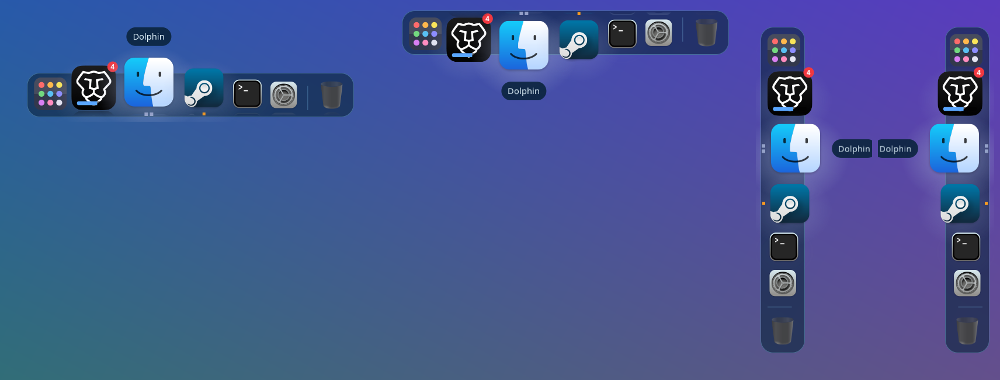
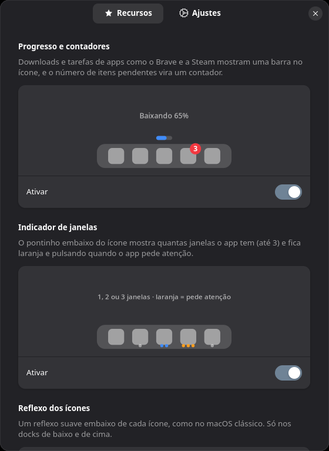

# mac-dock

Dock estilo macOS para **KDE Plasma (Wayland)**, em Python + GTK4 + layer-shell.


<sub>Mostra a ampliação com mola, o bounce ao abrir, a barra de progresso e o contador (Dolphin), os pontos de janelas, o ponto laranja de atenção (Steam) e o reflexo. Renderizada pelo próprio dock sobre um fundo de exemplo; no KDE de verdade o vidro desfoca o que está atrás.</sub>

- Ampliação dos ícones com física de mola e bounce ao abrir apps
- Apps abertos detectados via script do KWin, com indicador
- Menu do botão direito (ações do app, janelas, fixar/remover, minimizar todas, mover), arrastar para reordenar, lixeira
- Esconder automático, vidro com blur do KWin, temas Escuro, Claro, Vidro (estilo Apple), Grafite, Meia-noite, Oceano, Floresta e Sakura
- Lançador de apps em tela cheia (estilo Launchpad)

### Recursos



| Recurso | O que faz |
|---|---|
| Progresso e contadores | Barra no ícone e número de pendências (apps que usam `com.canonical.Unity.LauncherEntry`, como Brave e Steam) |
| Indicador de janelas | Até 3 pontos conforme o número de janelas; laranja e pulsando quando o app pede atenção |
| Reflexo dos ícones | Reflexo suave dentro do contorno do dock (docks de baixo e de cima) |
| Arrastar arquivos | Soltar um arquivo num app abre com ele; na lixeira, move para ela |
| Pré-visualização de janelas | Miniaturas ao passar o mouse (via KWin; sem permissão mostra ícone e título) |
| Esconder inteligente | O dock só recolhe quando uma janela o cobre |
| Posição | Embaixo, em cima, esquerda ou direita |
| Multi-monitor | Um dock por monitor, com os apps de cada tela |
| Temas e cor automática | Segue o claro/escuro e a cor de destaque do KDE |
| Idioma | Português, inglês e espanhol |



### Ajustes

A janela de ajustes tem a página **Recursos**: cada recurso vem com uma ilustração do que ele faz e uma chave de liga/desliga. A página **Ajustes** traz o resto (aparência, tela, ícones e modos).



Configuração em `~/.config/mac-dock/config.json`.

## Requisitos

Python 3, GTK 4, libadwaita, PyGObject, [gtk4-layer-shell](https://github.com/wmww/gtk4-layer-shell), KDE Plasma 6 em Wayland.

No Arch/CachyOS: `sudo pacman -S gtk4 libadwaita python-gobject gtk4-layer-shell`

## Uso

```
python3 dock.py          # roda o dock (rodar de novo abre os ajustes)
python3 dock.py --png X  # renderiza uma imagem de teste e sai
```

Para instalar (confere as dependências, liga o início com a sessão e autoriza as miniaturas no KWin): `./install.sh` (use `--dry-run` para só simular e `--uninstall` para remover).

Testes: `python3 -m unittest discover -s tests`.

O botão de menu usa `assets/launcher.png` se existir; sem ele, mostra uma grade. Use `launcher_icon` nos ajustes para escolher outra imagem.

## Licença

[MIT](LICENSE): use, modifique e distribua à vontade.
