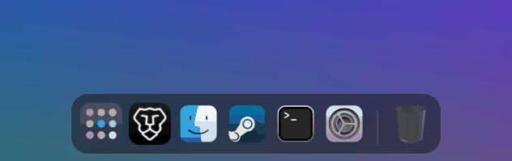

# mac-dock

Dock estilo macOS para **KDE Plasma (Wayland)**, em Python + GTK4 + layer-shell.



<sub>Demonstração renderizada pelo próprio dock sobre um fundo de exemplo; no KDE de verdade o vidro desfoca o que está atrás.</sub>

- Ampliação dos ícones com física de mola e bounce ao abrir apps
- Apps abertos detectados via script do KWin, com indicador
- Menu do botão direito (ações do app, janelas, fixar/remover), arrastar para reordenar, lixeira
- Esconder automático, vidro com blur do KWin, temas Escuro, Claro, Vidro (estilo Apple), Grafite e Meia-noite
- Lançador de apps em tela cheia (estilo Launchpad)
- Barra de progresso e contador no ícone, indicador de janelas (laranja quando o app pede atenção), reflexo opcional
- Soltar arquivos num ícone para abrir no app (ou na lixeira); mais ações no menu do botão direito
- Tema que segue o claro/escuro e a cor de destaque do KDE
- Janela de ajustes (libadwaita) com a página **Recursos**: cada recurso tem uma ilustração e uma chave de liga/desliga; configuração em `~/.config/mac-dock/config.json`

## Requisitos

Python 3, GTK 4, libadwaita, PyGObject, [gtk4-layer-shell](https://github.com/wmww/gtk4-layer-shell), KDE Plasma 6 em Wayland.

No Arch/CachyOS: `sudo pacman -S gtk4 libadwaita python-gobject gtk4-layer-shell`

## Uso

```
python3 dock.py          # roda o dock (rodar de novo abre os ajustes)
python3 dock.py --png X  # renderiza uma imagem de teste e sai
```

Para instalar (confere as dependências e liga o início com a sessão): `./install.sh` (use `--dry-run` para só simular e `--uninstall` para remover).

O botão de menu usa `assets/launcher.png` se existir; sem ele, mostra uma grade. Use `launcher_icon` nos ajustes para escolher outra imagem.

## Licença

[MIT](LICENSE): use, modifique e distribua à vontade.
